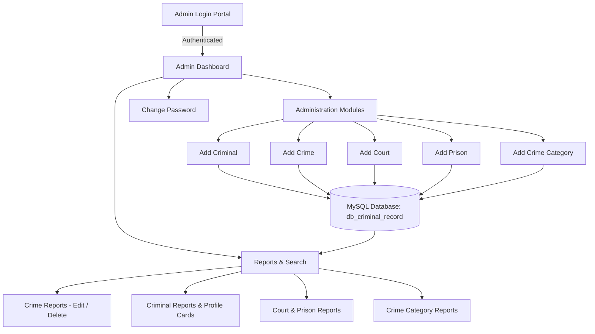

# Criminal Management System

A **5th-semester academic project** built with **Core PHP** and **MySQL** to digitize and manage criminal records, case registrations, court details, prison records, and crime classifications using full **CRUD (Create, Read, Update, Delete)** operations.

---

## System Architecture & Workflow Chart



---

## Key Features & CRUD Modules

| Module | Operations Supported | Description |
| :--- | :--- | :--- |
| **Admin Authentication** | Login, Password Update | Secures administrative access (`admin/`) with session validation and password management. |
| **Criminal Management** | Create, Read, Update, Delete | Registers criminal profiles with photo uploads, contact details, date of birth, address, and biometric metrics (height & weight). |
| **Crime Registration** | Create, Read, Update, Delete | Links registered criminals to specific crime categories, prisons, courts, dates, locations, and case descriptions. |
| **Court Management** | Create, Read, Update, Delete | Maintains court records including court name, court type, location, and description. |
| **Prison Management** | Create, Read, Update, Delete | Tracks correctional facilities, locations, and facility details. |
| **Crime Category Management** | Create, Read, Update, Delete | Organizes offense classifications and descriptions across the system. |
| **Reports & Search** | Read, Filter, Edit, Delete | Displays structured tables and profile cards with quick search filtering and instant action controls. |

---

## Database Schema (`db_criminal_record`)

| Table Name | Purpose |
| :--- | :--- |
| `tbl_admin` | Stores administrator credentials and login details. |
| `tbl_criminal` | Stores personal details, biometrics, contact info, and photo paths of registered criminals. |
| `tbl_crime` | Stores registered crime incidents linked to criminal, category, prison, and court IDs. |
| `tbl_crime_category` | Stores master crime types and descriptions. |
| `tbl_court` | Stores master court names, types, and locations. |
| `tbl_prison` | Stores master prison names, locations, and descriptions. |

---

## Tech Stack

| Layer | Technology |
| :--- | :--- |
| **Backend** | Core PHP |
| **Database** | MySQL (`phpMyAdmin`) |
| **Frontend** | HTML5, CSS3, JavaScript, Bootstrap |
| **Local Server** | XAMPP (Apache & MySQL) |

---

## Project Screenshots

| Crime Registration Form | Crime Reports |
| :---: | :---: |
|  |  |

| Criminal Reports Table | Criminal Profile Cards & Search |
| :---: | :---: |
|  |  |

| Court Reports | Prison Reports |
| :---: | :---: |
|  |  |

| Crime Category Reports |
| :---: |
|  |

---

## Local Setup & Installation

1. **Install XAMPP:** Download and install XAMPP on your system, then start **Apache** and **MySQL** from the XAMPP Control Panel.
2. **Place Project Files:** Copy this repository into your `htdocs` folder:
   ```text
   C:\xampp\htdocs\crms\Criminal_Management_System
   ```
3. **Create Database:** Open `http://localhost/phpmyadmin`, click **New**, and create a database named:
   ```text
   db_criminal_record
   ```
4. **Import SQL File:** Select `db_criminal_record`, open the **Import** tab, choose `database/db_criminal_record.sql`, and click **Import**.
5. **Run the Application:** Open your browser and visit:
   ```text
   http://localhost/crms/Criminal_Management_System/admin/
   ```
